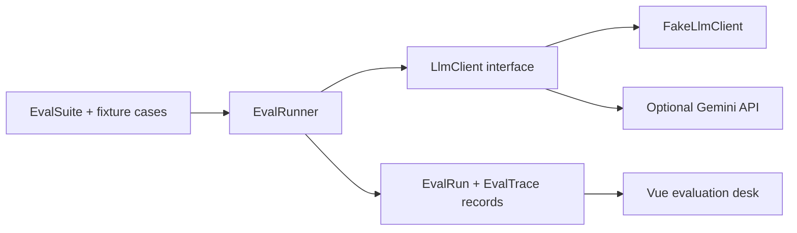

# Prompt Eval Lab

Prompt Eval Lab is a small evaluation desk for testing customer-support prompts against repeatable fixtures. Run a suite, review each model response and substring assertion, and keep a persisted pass/fail trace for every case and run.

## How it works



`EvalRunner` sends each fixture's input and the suite's system prompt through `App\Services\Llm\LlmClient`. A trace passes when its output contains the fixture's expected text, compared case-insensitively. Each run stores its model name, pass/fail totals, response output, and latency. Provider exceptions become failed traces with a readable message, so a model outage does not interrupt the run with an unhandled server error.

The demo suite, **Support tone**, covers a refund apology, opening hours, an unknown inventory question, and refusal of medical advice. Its deterministic fake intentionally produces three passes and one failure so the desk demonstrates both outcomes without external services.

## Run locally without an API key

Requirements: PHP 8.3+, Composer, Node.js 20+, and npm.

```bash
composer install
cp .env.example .env
php artisan key:generate
```

On Windows PowerShell, use `Copy-Item .env.example .env` instead of `cp`.

Create the local SQLite file if it does not exist, then migrate and seed the demo suite:

```bash
touch database/database.sqlite
php artisan migrate --seed
npm install
npm run build
php artisan serve
```

On Windows PowerShell, create it with `if (-not (Test-Path database/database.sqlite)) { New-Item -ItemType File database/database.sqlite }`.

Open [http://localhost:8000](http://localhost:8000). The app is guest-accessible; there are no demo login credentials. `GEMINI_API_KEY` is blank by default, so the deterministic fake client is selected automatically. To use Gemini instead, add a key to `.env` (optionally set `GEMINI_MODEL`) and restart the app. Requests to Gemini have a 12-second timeout.

To run the complete test suite:

```bash
php artisan test
```

## Tests and AI behavior

Pest feature tests run the seeded suite using `FakeLlmClient`, not a live API. They verify that a run persists exactly four traces and scores three passes / one failure; rerunning creates a separate `EvalRun`; guest submissions return HTTP 200; matching is case-insensitive; provider exceptions persist failed traces rather than returning a 500; and the evaluation desk renders to guests.

## Stack

- Laravel 13 and PHP 8.3+
- Vue 3, Inertia, TypeScript, and Tailwind CSS
- SQLite by default; no Redis or third-party evaluation service
- Optional Gemini `generateContent` adapter behind the `LlmClient` interface
